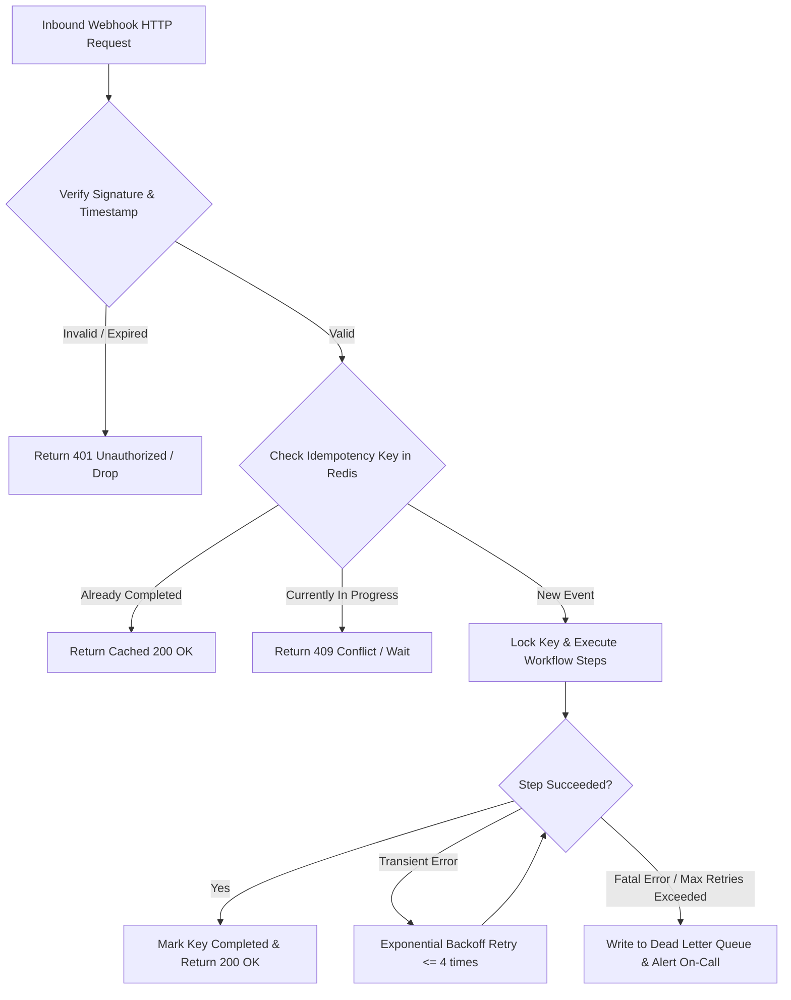

# Integration and Workflow Patterns Reference

This reference documents architectural patterns for business workflow automations across n8n, Zapier, Make, and webhook microservices.

## 1. Webhook Security and Ingestion Protocol

## 2. Standard Idempotency Key Headers

When publishing or receiving webhook events, standardize on one of these recognized header contracts:
- `Idempotency-Key: <uuid-v4>` (IETF Draft Standard)
- `X-Event-ID: <unique-provider-event-id>` (Provider-specific, e.g. Stripe `evt_1...`)

## 3. Safe Schema Mapping Rules

- **Strict Type Validation**: Always validate payload types before performing database writes. Convert incoming numeric strings to integers/floats explicitly.
- **Null Safety**: Map missing optional keys to `null` rather than omitting them or relying on `undefined`.
- **Secret Redaction**: Never pass raw authorization tokens, database connection strings, or full credit card numbers across log streams or unencrypted webhook payloads.
