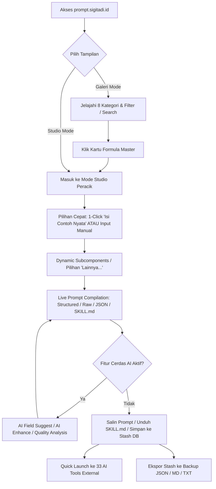

# SPESIFIKASI PRODUK (PRD): PromptMatrix 2.0

> **Sistem:** PromptMatrix 2.0 - Guided AI Prompt Studio & Agent Skill Builder  
> **Arsitek & Pemilik:** Sigit Adi ([https://sigitadi.id](https://sigitadi.id))  
> **Domain Live:** [https://prompt.sigitadi.id](https://prompt.sigitadi.id)  
> **Versi Saat Ini:** v7.2.1  
> **Lisensi:** MIT  
> **Standar Rekayasa:** Dikelola oleh RetroBOT (`RetroBOT.md`)

---

# ==============================================================================

# ZONA ATAS: BLUEPRINT AWAL (SISTEM & ARSITEKTUR)

# ==============================================================================

## 1. Latar Belakang & Masalah (Problem Statement)

1. **The Blank Canvas Problem:** Pengguna sering mengalami kebuntuan saat berhadapan dengan chatbox AI kosong, menghasilkan prompt yang ambigu, terlalu singkat, atau minim konteks.
2. **Kualitas Output Rendah:** Tanpa persona yang spesifik, batasan format, dan variabel konteks terstruktur, model LLM cenderung berhalusinasi atau memberikan respon umum yang tidak dapat langsung dieksekusi.
3. **Kompleksitas Multi-Modal & Multi-Platform:** Menulis prompt untuk Midjourney v7, FLUX.2, Suno v4.5/v5, Veo 3, Kling 2.1, Sora 2, atau DeepSeek-R1/V3 membutuhkan sintaks, parameter, dan formula yang sangat berbeda satu sama lain.
4. **Isu Privasi Data:** Banyak generator prompt berbasis cloud menyimpan input dan ide pengguna di server pihak ketiga tanpa transparansi.

## 2. Visi Produk & Solusi Utama

PromptMatrix 2.0 adalah platform **Guided AI Prompt Engine** berbasis client-side murni yang menyediakan **400 formula master** lintas 8 kategori dan 83 subkategori, memandu pengguna meracik instruksi berkualitas tinggi secara visual, terstruktur, dwibahasa (ID/EN), serta mengekspor definisi `SKILL.md` siap pakai untuk 27 runtime AI coding agent dan katalog Agensi.io.

## 3. Persona Pengguna & Peran Sistem

- **Pemula / Casual:** Memanfaatkan fitur *1-Click Fill Sample* dan tombol *Quick Launch* untuk langsung belajar dan mencoba prompt ke ChatGPT/Claude/Gemini.
- **Content Creator & Marketer:** Meracik formula AIDA, PAS, Hook-Story-Offer, GEO/AEO, Script Video TikTok/Reels, dan Copywriting iklan.
- **Software Engineer & DevOps:** Menggunakan template arsitektur backend, TypeScript strict zero-any, MCP Server v2, refactoring, dan ekspor `SKILL.md` untuk Claude Code/Cursor/Windsurf/Antigravity.
- **Creative Designer & Musisi:** Mengonstruksi prompt Midjourney v7 / FLUX.2 berparameter teknis (`--ar`, `--v 7`, `--oref`, lighting, lens), Veo 3 / Kling 2.1 / Sora 2, dan prompt lirik/genre Suno v4.5/v5.
- **Power User / AI Enthusiast:** Mengaktifkan fitur AI Pro via *9-Tap Logo Unlock*, menghubungkan API Key Gemini/Claude/OpenAI/DeepSeek/Ollama lokal untuk fitur *AI Suggest*, *AI Enhance*, dan *Quality Scoring*.

## 4. Alur Kerja Pengguna (User Journey / Flow)



## 5. Arsitektur Data & Skema Komponen

- **Master Framework Structure (`data/frameworks.ts`):**
  - Deklaratif, 400 frameworks dalam format hierarkis: `Category -> Subcategory -> Framework` (8 kategori, 83 subkategori).
  - Mencakup formula reasoning modern (GPT-5, o3, o4-mini, Claude 4 / Sonnet 4.5, Gemini 3.7, DeepSeek R1/V3), multimodal generasi terbaru (Midjourney v7, FLUX.2 / Kontext, Veo 3, Kling 2.1, Sora 2, Suno v4.5/v5), serta agentic coding & workflow (`SKILL.md` builder, MCP Server v2, Claude Code Subagents & Hooks, Cursor & Windsurf Multi-Repo Rules).
  - Komponen input dinamis: `text`, `textarea`, `select`, `slider`, `number`, `multiselect`, `date`, `color`, dan `dynamicSubcomponents`.
- **Lokal Storage & IndexedDB (`PromptMatrixDB`):**
  - Store: `userPrompts` (keyPath: `id`, autoIncrement: `true`).
  - Menyimpan snapshot formulir, prompt hasil kompilasi, timestamp, dan catatan pengguna.
  - Export Stash ke file JSON (backup/restore) dan Markdown `.md` (dokumentasi rapi).
- **Konfigurasi AI (`localStorage`):**
  - Menyimpan API Key, pilihan model, dan custom Base URL secara lokal di browser pengguna (Zero Server Ingestion).
  - Dilengkapi sanitizer otomatis `sanitizePromptText` untuk mencegah kebocoran markdown fence (```markdown) dan bold asterisks (**) saat AI Enhance.

## 6. Antarmuka UI/UX (Human-Crafted Aesthetic)

- **Tema & Warna:** Dark slate premium (`bg-[#090d16]` & `bg-slate-900`) dengan aksen emerald (`teal-500/emerald-400`) dan purple AI accents.
- **Layout:**
  - *Galeri View*: Grid responsif kartu formula dengan visual badges, count pill, intent search tags, dan zero-emoji SVG icons (termasuk pada Stash modal).
  - *Studio View*: Split 2 kolom (58% formulir bertahap & 42% sticky live preview dengan hitungan karakter dan perkiraan token).
- **Aksesibilitas & Resiliensi:** ErrorBoundary mempertahankan API keys (`pm_ai_settings`) dan status aktivasi (`pm_ai_unlocked`) saat pengguna melakukan reset cache darurat.
- **Performa Bundling:** Vite code-splitting via `manualChunks` memecah bundle data (`data-frameworks`, `data-localization`, `vendor-react`) sehingga bundle utama berukuran ultra-ringan (~147 kB).

## 7. Rencana Pengujian & Kriteria Keberhasilan

- Build tanpa error pada Vite + TypeScript strict mode (< 4 detik).
- 100% dari 400 formula terkompilasi dengan bersih ke format `AI Logic: ...` dan variabel input, serta valid diekspor ke JSON RFC 8259 maupun `SKILL.md` Open Agent Skills.
- Sinkronisasi dual-bahasa (ID <-> EN) konsisten di seluruh 400 framework dan ribuan entri label, opsi, serta placeholder tanpa kunci translasi yang hilang.
- Fungsi IndexedDB (Create, Read, Update, Delete, Export JSON, Export Markdown, Import) berjalan tanpa konflik ID.

---

# ==============================================================================

# ZONA BAWAH: LIVING CONTEXT (STATUS AKTIF & REGISTER TEKNOLOGI)

# ==============================================================================

### Status Sistem Terkini (v7.2.1 - Agensi.io Hybrid Monetization Engine, 10 Skill Packs & 400 Master Formulas)

- **Framework Utama:** React 18.0.0 (Functional Components + Hooks)
- **Bahasa & Compiler:** TypeScript 5.5.4 + Vite 5.4.19
- **Styling Engine:** Tailwind CSS v4.1.10 + PostCSS 8
- **Penyimpanan Klien:** Native IndexedDB (`db.ts`, Store: `userPrompts`) + Safe LocalStorage
- **PWA & Offline Capability:** Service Worker Cache-First (`public/sw.js`) + Manifest PWA 2026 Ready (`public/manifest.json`)
- **Hosting & CI/CD:** GitHub Actions -> GitHub Pages + Vercel / Netlify Rewrite Ready (`public/CNAME`, `public/_redirects`)
- **Domain Resmi:** `https://prompt.sigitadi.id`
- **Total Master Formulas:** 400 Formulas Terverifikasi di 8 Kategori & 83 Subkategori (100% Searchable, Localized Dua Arah ID <-> EN)
- **Paket Agent Skills (`agensi-skills/`):** 10 Paket Open Agent Skills siap pakai & siap kemas via `npm run package:skills` ke `dist-agensi/*.zip` + `AGENSI-LISTING-MANIFEST.md` (`prompt-matrix-prompt-architect` [$0 Free], `multimodal-video-image-director` [$9.99], `seo-geo-aeo-content-engine` [$11.99], `antislop-ui-and-copy-auditor` [$12.00], `fullstack-ts-nextjs-architect` [$14.99], `mcp-server-production-builder` [$14.99], `postgres-prisma-zero-downtime-sql-tuner` [$14.99], `playwright-e2e-and-openapi-contract-suite` [$14.99], `owasp-api-and-cloud-security-auditor` [$19.99], `multi-agent-swarm-and-subagent-orchestrator` [$19.99])
- **Paket Fitur Lengkap Audit (v6.7.0 & v6.8.0):**
  - **A1. Pagination Batch 24:** Mengeliminasi 15-layar infinite scroll menjadi 3 layar awal + muat bertahap.
  - **A2. Mobile Portfolio Link + Logo SA:** Logo resmi SA (`/sa-logo.png`) selalu terlihat di header mobile & footer.
  - **A3. Scroll-to-Top Floating Button:** FAB `↑` muncul saat scroll > 400px.
  - **A4. Sticky Category Quick Nav:** Baris navigasi kategori melayang di bawah sticky header (`top-16 z-30`) saat scroll ke bawah.
  - **A5. Quick Nav "Ke Atas" di Footer:** Tautan cepat kembali ke atas pada footer.
  - **A6. Skeleton Loading Cards:** Animasi pulse placeholder saat pergantian filter/kategori/sort, menghilangkan layout shift.
  - **B7. Recently Used Section:** Riwayat 5 template terakhir tersimpan di `localStorage` dengan chip akses instan 1-klik.
  - **B8. Popular / Trending Badges:** Lencana `🔥 Populer` otomatis disematkan pada formula andalan.
  - **B9. Dynamic Sort Options:** Pengurutan (Default, Populer Teratas, Nama A-Z, Nama Z-A, Input Terbanyak/Tersedikit).
  - **B10. PWA Offline Mode:** Service worker `sw.js` menyimpan aset statis offline.
  - **B11. Keyboard Shortcuts:** `Ctrl+K` untuk pencarian instan dan `Esc` untuk reset.
  - **B12. Clean Deep-Link Sharing:** Salin tautan bersih berbasis slug tanpa `%20` (`/?f=rtf-framework`) dengan auto-open slug parser.
  - **C13. High-Performance Virtualization & Chunking:** DOM hemat memori dengan rendering 24-batch.
  - **C14. Preload Assets:** Preload logo SA dan og-preview di `index.html`.
  - **C15. Compact Mobile Hero:** Teks pengantar mobile dipangkas agar input dan kategori langsung muncul di layar pertama.
  - **D16. 100% Comprehensive Sample Auto-Fill (v6.8.0):** Mengisi seluruh isian tanpa terkecuali (termasuk dynamic subcomponents, multiselect, date, slider, number, code) sebagai acuan ide AI.
  - **D17. Clean Fullscreen Preview Header (v6.8.0):** Menghapus teks repetitif "Layar Penuh" pada pratinjau prompt, mempertahankan ikon tunggal yang elegan.
  - **D18. Compact & Non-Repetitive Mobile Footer (v6.8.0):** Menghilangkan perulangan kata "PromptMatrix", merapikan tata letak mobile secara ringkas dan informatif.
  - **D19. Maximum SEO, GEO, AEO & OG Ready (v6.8.0):** Mengintegrasikan schema `FAQPage`, `HowTo`, `WebApplication` v6.8.0, geographic signals, dan OpenGraph preview 360+ formula.
  - **D20. Few-Shot Example Builder (v6.9.0):** Akordion interaktif opsional untuk menyisipkan contoh masukan & keluaran (+40% presisi instruksi LLM).
  - **D21. Side-by-Side Prompt Comparison Modal (v6.9.0):** Modal komparasi berdampingan untuk menguji Versi A (hasil formulir) vs Versi B (variasi yang dapat diedit langsung).
  - **D22. Multi-Format Stash Export (v6.9.0):** Dukungan ekspor koleksi prompt ke format JSON, Markdown (`.md`), dan Plain Text (`.txt`).
  - **D23. Interactive PWA Install Button (v6.9.0):** Tombol pasang otomatis di Header yang mendeteksi `beforeinstallprompt` perangkat.
  - **D24. Vite Chunking & Performance Optimization (v6.9.0):** Isolasi chunk mandiri untuk modul AI dan Stash memori.
  - **D25. 360+ Formulas Complete Catalog & GEO/AEO Index (v6.9.0):** Pembaruan berkas katalog publik `DaftarKerangkaKerja.md` untuk perayap sitasi AI.
  - **D26. Visual Mockup & Benchmark Engine (v7.0.0):** Pratinjau visual terkurasi untuk seluruh 360 template di 8 kategori yang 100% selaras dengan skenario isian otomatis (*1-Click Sample*). Mengeliminasi ketergantungan API pihak ketiga (bebas limit kuota), dilengkapi Lightbox Zoom modal, ringkasan parameter kunci, dan tombol unduh gambar lokal. Bekerja 100% tanpa fitur AI aktif (Zero API Key & Zero Token Cost).
  - **D27. Clean JSON Prompt Preview with Zero Decode Errors (v7.1.0):** Mode pratinjau JSON berstandar RFC 8259 yang bersih dan bebas *decode error* (`json.decoder.JSONDecodeError` / control character syntax errors). Dilengkapi pewarnaan sintaks interaktif, nomor baris monospace IDE, 3 sub-format (Struktur Penuh, Format Chat API `messages`, dan String Prompt Aman), serta tombol salin 1-klik yang tervalidasi internal.
  - **D28. Agent Skill SKILL.md Preview, Export & Agensi.io Integration (v7.2.0 - Gerbang Privat AI Pro):** Mode pratinjau keempat (`SKILL.md`) di Studio dan Modal Layar Penuh (`services/agentSkillService.ts`, `components/AgentSkillViewer.tsx`, `config/agensiConfig.ts`) yang digabung ke dalam gerbang `showAIFeatures` bersama Pengaturan Provider AI (`components/AISettingsModal.tsx`) agar tidak tampil di publik sebelum 9-tap logo unlock. Mengonversi formula aktif menjadi dokumen Open Agent Skills berfrontmatter YAML valid (`name <= 64` kebab-case, `description <= 1024`), dilengkapi badge validasi langsung, salin 1-klik, unduh `-SKILL.md`, dukungan 27 runtime agen, serta tab manajemen 6 bundel Agent Skills di `agensi-skills/`.
  - **D29. 400 Master Formulas Upgrade & Late-2026 Flagship Model Alignment (v7.2.0):** Ekspansi basis data dari 360 menjadi 400 formula master di 8 kategori dan 83 subkategori, audit & revisi 16 provider AI beserta model flagship akhir 2026 (`gemini-4-hydrogen`, `gemini-4-carbon`, `gemini-3.8-flash`, `gpt-6-astra`, `gpt-6.1-sol`, `claude-sonnet-5-5`, `claude-opus-5-5`, `claude-fable-5-2`, `deepseek-v4-pro`, `deepseek-flash`, `grok-4.7`, `grok-420-reasoning`, `command-a-plus-05-2026`, Llama 4 Maverick, Qwen 3.8, Gemma 4, Midjourney v8.2, FLUX.3/FLUX.2, Veo 3.1, Kling 3.0, Runway Gen-4.5, Suno v6), serta sinkronisasi penuh lokalisasi ID <-> EN, sample data, dan visual benchmark.
  - **D30. Pembersihan Model AI Defunct & Integrasi Model Frontier 2026 (v7.2.1):** Penyelarasan menyeluruh arsitektur model frontier aktif lintas seluruh provider: penempatan Google Gemini 4 Carbon (Heavyweight Frontier Reasoning) & Argon (Optimized Frontier Intelligence) di posisi utama bersama Hydrogen, penyelarasan OpenAI GPT-6 (Sol, Astra, Terra, Luna) & Anthropic Claude 5.5 (Sonnet 5.5, Opus 5.5, Fable 5.2), penghapusan model yang telah dimatikan/deprecated (Gemini 2.0 Flash, Gemini 1.5, GPT-4o, Claude 3 legacy), pembersihan tata letak footer responsif SKILL.md, eliminasi strict TypeScript TS2783/TS2688, serta penyempurnaan kartu OpenAI-Compatible di Pengaturan AI.
  - **D31. Agensi.io Hybrid Monetization Engine, 1-Click Browser `.zip` Factory & 10 Packaged Skills (v7.2.1):** Pemisahan arsitektur menjadi Public Affiliate Storefront (`Header` tombol `Skills 10`, `TemplateGallery` banner katalog, `AgensiSkillPromoCard` kontekstual per kategori di Studio, dan `AgensiCatalogModal` dengan filter All/Free/Paid tanpa tombol unduh `.zip` publik) serta Private Creator Mode di balik *9-Tap Logo Unlock* (`AgentSkillViewer` dilengkapi 1-klik export `.zip` browser berbasis `services/skillZipService.ts` + generator *Copy Listing Copy* `Agensi.io/sell`, serta `AISettingsModal` tab Paket Skill untuk konfigurasi override URL afiliasi/toko di `localStorage`). Seluruh 10 bundel di `agensi-skills/` dilengkapi skrip validator offline (termasuk `validate-multimodal-params.mjs` dan 4 paket flagship baru), serta CLI zero-dependency `npm run package:skills` (`scripts/package-agensi-skills.mjs`) yang memvalidasi keamanan, menghasilkan 10 arsip POSIX `<slug>.zip` ber-`SKILL.md` di root (`< 50 MB`), dan menerbitkan `dist-agensi/AGENSI-LISTING-MANIFEST.md` lengkap dengan SOP payout Zoneless USDC Solana untuk Indonesia.

### Register Modul & Komponen Utama

| Berkas / Direktori | Tanggung Jawab Teknis |
| :--- | :--- |
| `App.tsx` | State orchestrator utama (viewMode, formValues, stash CRUD & Export MD, toast, prompt compiler, 9-tap logo unlock, scroll-to-top FAB, `previewViewMode` structured/raw/json/skill dengan `skill` tersembunyi di publik, integrasi `AgensiSkillPromoCard` & `AgensiCatalogModal`, dan 34 Quick Launchers) |
| `config/agensiConfig.ts` | Konfigurasi integrasi Agensi.io (URL marketplace, parameter komisi kreator/afiliasi, katalog 10 bundel `bundledSkillPacks` beserta harga/kategori/file, helper `pm_agensi_urls`, `buildAgensiPackCtaUrl`, `getContextualSkillPacksForCategory`, dan daftar 27 runtime Open Agent Skills yang didukung) |
| `services/agentSkillService.ts` | Service konversi state formula aktif menjadi spesifikasi Open Agent Skills (`AgentSkillSpec`), generator kebab-case `<= 64` char, validator frontmatter YAML, dan formatter `SKILL.md` |
| `services/skillZipService.ts` | Engine pembuat arsip ZIP murni TypeScript (CRC-32 + Store method 0 + POSIX paths) di browser untuk mengekspor paket `.zip` Agensi.io (`SKILL.md`, `references/framework-guide.md`, `templates/sample-input.json`, `scripts/validate-output.mjs`) dan generator Listing Copy Markdown siap tempel |
| `components/AgentSkillViewer.tsx` | Visualizer `SKILL.md` berpewarnaan sintaks YAML/Markdown, indikator validasi `name`/`description`, strip 27 agen didukung, tombol unduh `.zip` Agensi.io, *Salin Listing Copy*, unduh `-SKILL.md`, dan info kesiapan Agensi.io |
| `components/AgensiSkillPromoCard.tsx` | Kartu promosi kontekstual publik di Studio yang memetakan kategori formula aktif ke paket Flagship Agensi.io + lead magnet `$0 Free` dan tombol pembuka katalog |
| `components/AgensiCatalogModal.tsx` | Modal katalog publik 10 paket Agent Skills dengan filter All/Free/Paid, badge harga, daftar file & 27 agen; rute afiliasi untuk pengunjung publik dan kontrol *Salin Listing Copy* saat Creator Mode aktif |
| `components/CleanJsonViewer.tsx` | Komponen visualizer JSON interaktif dengan pewarnaan sintaks murni React JSX, nomor baris monospace, sub-format switch, dan tombol salin terintegrasi |
| `services/jsonPromptService.ts` | Service pembuat dan sanitizer payload prompt JSON berstandar RFC 8259 dengan validasi internal nol decode error untuk Python, cURL, dan LLM API |
| `components/VisualPromptPreview.tsx` | Komponen visual mockup & benchmark hasil prompt terkurasi untuk seluruh template dan lightbox zoom modal |
| `components/TemplateGallery.tsx` | Galeri visual 400 kartu formula, pagination 24-batch, pencarian intent, category switcher, banner katalog 10 Agent Skills, dan badge Populer |
| `components/FrameworkPane.tsx` | Formulir interaktif dinamis, integrasi Mockup Visual & Contoh Hasil tepat di bawah judul & deskripsi, tombol *1-Click Isi Contoh Nyata*, AI suggestion per-field |
| `components/Header.tsx` | Navigasi atas, logo tap trigger, tombol publik `Skills (10)` pembuka katalog Agensi.io, portfolio link dengan logo SA (selalu terlihat di mobile & desktop), language switcher (ID/EN), theme switcher (Dark/Light) |
| `components/Footer.tsx` | Metadata, copyright Sigit Adi, link portfolio sigitadi.id dengan logo SA, kontak email & sosial |
| `components/AISettingsModal.tsx` | Modal terpadu privat (hanya tampil saat `showAIFeatures` aktif): Tab Provider & Model AI (Gemini 4, Claude 5.5, GPT-6, DeepSeek V4/R1, xAI Grok 4.7, Cohere, HF Router, Ollama, Custom URL) + Tab Paket Skill (konfigurasi URL afiliasi/toko `pm_agensi_urls`, 10 bundel `agensi-skills/`, & salin Listing Copy) |
| `services/visualBenchmarkService.ts` | Registry kurasi gambar benchmark gold-standard untuk 400 formula, deteksi rasio aspek prompt, sanitizer teks prompt untuk engine render publik |
| `services/universalAIService.ts` | Dispatcher universal pemanggilan AI multi-provider dengan SSE stream parser, error handler, dan sanitizer markdown |
| `services/aiSettingsService.ts` | Manajemen preset provider, model default late-2026, dan persistensi `localStorage` |
| `services/localizationService.ts` | Basis data translasi 8.600+ entri & mapping bilingual ID <-> EN presisi (400 framework names, descriptions & AI logics) |
| `services/sampleDataService.ts` | Data sample realistis untuk pengisian formulir otomatis 1-klik di seluruh 400 formula |
| `data/frameworks.ts` | Master repository 400 framework lintas 8 kategori dan 83 subkategori beserta definisi komponen dinamis |
| `agensi-skills/` | 10 paket Open Agent Skills siap pakai (`SKILL.md`, `references/`, `scripts/`, `templates/`) untuk distribusi & publikasi ke Agensi.io |
| `scripts/package-agensi-skills.mjs` | Packager CLI zero-dependency (`npm run package:skills`) yang memvalidasi 10 paket, membangun `dist-agensi/<slug>.zip` ber-POSIX root `SKILL.md` (`< 50 MB`), dan mencetak `dist-agensi/AGENSI-LISTING-MANIFEST.md` |
| `scripts/audit-frameworks.mjs` | Gerbang audit terprogram (`npm run audit`) untuk validasi 400 formula, 100% lokalisasi, 10 paket `SKILL.md`, 0 em-dash, dan 0 buzzword |
| `db.ts` | Wrapper IndexedDB untuk Stash (CRUD + JSON Export/Import) |

### Fitur Rahasia & Kontrol Akses (Security by Discretion)

- **9-Tap Logo Unlock & Hybrid Public Storefront:** Tombol logo pada header dapat diklik 9 kali berturut-turut untuk membuka/menutup fitur AI Pro dan Creator Mode (`pm_ai_unlocked`). Dalam mode publik bawaan (`pm_ai_unlocked !== 'true'`), etalase afiliasi katalog 10 Agent Skills (`Header` tombol `Skills`, `TemplateGallery` banner, `AgensiSkillPromoCard`, dan `AgensiCatalogModal`) tampil terbuka untuk konversi pengunjung tanpa mengekspos tombol ekspor `.zip`. Saat 9-Tap Creator Mode aktif, tombol Pengaturan Provider AI & Paket Skill di header, *Suggest AI*, *AI Enhance*, *Quality Analysis*, tab `SKILL.md` beserta 1-klik ekspor `.zip` (`skillZipService.ts`), dan *Copy Listing Copy* terbuka sepenuhnya.
