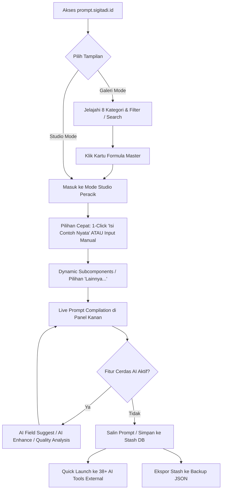

# SPESIFIKASI PRODUK (PRD): PromptMatrix 2.0

> **Sistem:** PromptMatrix 2.0 - Ultimate Guided AI Prompt Generator  
> **Arsitek & Pemilik:** Sigit Adi ([https://sigitadi.id](https://sigitadi.id))  
> **Domain Live:** [https://prompt.sigitadi.id](https://prompt.sigitadi.id)  
> **Versi Saat Ini:** v7.0.0  
> **Lisensi:** MIT  
> **Standar Rekayasa:** Dikelola oleh RetroBOT (`RetroBOT.md`)

---

# ==============================================================================
# ZONA ATAS: BLUEPRINT AWAL (SISTEM & ARSITEKTUR)
# ==============================================================================

## 1. Latar Belakang & Masalah (Problem Statement)
1. **The Blank Canvas Problem:** Pengguna sering mengalami kebuntuan saat berhadapan dengan chatbox AI kosong, menghasilkan prompt yang ambigu, terlalu singkat, atau minim konteks.
2. **Kualitas Output Rendah:** Tanpa persona yang spesifik, batasan format, dan variabel konteks terstruktur, model LLM cenderung berhalusinasi atau memberikan respon umum yang tidak dapat langsung dieksekusi.
3. **Kompleksitas Multi-Modal & Multi-Platform:** Menulis prompt untuk Midjourney v6.1, Suno v4, Runway Gen-3, atau DeepSeek-R1 membutuhkan sintaks, parameter, dan formula yang sangat berbeda satu sama lain.
4. **Isu Privasi Data:** Banyak generator prompt berbasis cloud menyimpan input dan ide pengguna di server pihak ketiga tanpa transparansi.

## 2. Visi Produk & Solusi Utama
PromptMatrix 2.0 adalah platform **Guided AI Prompt Engine** berbasis client-side murni yang menyediakan **350 formula master** lintas 8 kategori industri, memandu pengguna meracik instruksi berkualitas tinggi secara visual, terstruktur, dwibahasa (ID/EN), dan dilengkapi integrasi Universal AI bawaan.

## 3. Persona Pengguna & Peran Sistem
- **Pemula / Casual:** Memanfaatkan fitur *1-Click Fill Sample* dan tombol *Quick Launch* untuk langsung belajar dan mencoba prompt ke ChatGPT/Claude/Gemini.
- **Content Creator & Marketer:** Meracik formula AIDA, PAS, Hook-Story-Offer, Script Video TikTok/Reels, dan Copywriting iklan.
- **Software Engineer & DevOps:** Menggunakan template arsitektur backend, refactoring, unit testing, dan system design prompt.
- **Creative Designer & Musisi:** Mengonstruksi prompt Midjourney berparameter teknis (`--ar`, `--v 6.1`, lighting, lens) dan prompt lirik/genre Suno AI.
- **Power User / AI Enthusiast:** Mengaktifkan fitur AI Pro via *9-Tap Logo Unlock*, menghubungkan API Key Gemini/Claude/DeepSeek/Ollama lokal untuk fitur *AI Suggest*, *AI Enhance*, dan *Quality Scoring*.

## 4. Alur Kerja Pengguna (User Journey / Flow)


## 5. Arsitektur Data & Skema Komponen
- **Master Framework Structure (`data/frameworks.ts`):**
  - Deklaratif, 360 frameworks dalam format hierarkis: `Category -> Subcategory -> Framework`.
  - Termasuk 10 Masterclass Templates 2026: Reasoning Models GCC (Claude 3.7 & DeepSeek-R1), Midjourney v6.1 (--cref & --sref), FLUX.1 Descriptive Studio, Kling 1.5 & Runway Gen-3 Director, Suno v4 Lyrical Architect, AI Coding Agent Rules (.cursorrules & Windsurf), MCP Server & Tool Designer, AIDA Klasik Copywriting, TikTok Shop Live Stream Script, dan LPDP Essay Architect.
  - Komponen input dinamis: `text`, `textarea`, `select`, `slider`, `number`, `multiselect`, `date`, `color`, dan `dynamicSubcomponents`.
- **Lokal Storage & IndexedDB (`PromptMatrixDB`):**
  - Store: `userPrompts` (keyPath: `id`, autoIncrement: `true`).
  - Menyimpan snapshot formulir, prompt hasil kompilasi, timestamp, dan catatan pengguna.
  - Export Stash ke file JSON (backup/restore) dan Markdown `.md` (dokumentasi rapi).
- **Konfigurasi AI (`localStorage`):**
  - Menyimpan API Key, pilihan model, dan custom Base URL secara lokal di browser pengguna (Zero Server Ingestion).
  - Dilengkapi sanitizer otomatis `sanitizePromptText` untuk mencegah kebocoran markdown fence (```markdown) dan bold asterisks (**) saat AI Enhance.

## 6. Antarmuka UI/UX (Human-Crafted Aesthetic)
- **Tema & Warna:** Dark slate premium (`bg-[#090d16]` & `bg-slate-900`) dengan aksen emerald (`teal-500/emerald-400`) dan purple AI accents.
- **Layout:**
  - *Galeri View*: Grid responsif kartu formula dengan visual badges, count pill, intent search tags, dan zero-emoji SVG icons (termasuk pada Stash modal).
  - *Studio View*: Split 2 kolom (58% formulir bertahap & 42% sticky live preview dengan hitungan karakter dan perkiraan token).
- **Aksesibilitas & Resiliensi:** ErrorBoundary mempertahankan API keys (`pm_ai_settings`) dan status aktivasi (`pm_ai_unlocked`) saat pengguna melakukan reset cache darurat.
- **Performa Bundling:** Vite code-splitting via `manualChunks` memecah bundle data (`data-frameworks`, `data-localization`, `vendor-react`) sehingga bundle utama berukuran ultra-ringan (~147 kB).

## 7. Rencana Pengujian & Kriteria Keberhasilan
- Build tanpa error pada Vite + TypeScript strict mode (< 4 detik).
- 100% dari 360 formula terkompilasi dengan bersih ke format `AI Logic: ...` dan variabel input.
- Sinkronisasi dual-bahasa (ID ↔ EN) konsisten di 4.300+ entri tanpa kunci translasi yang hilang.
- Fungsi IndexedDB (Create, Read, Update, Delete, Export JSON, Export Markdown, Import) berjalan tanpa konflik ID.

---

# ==============================================================================
# ZONA BAWAH: LIVING CONTEXT (STATUS AKTIF & REGISTER TEKNOLOGI)
# ==============================================================================

### Status Sistem Terkini (v7.0.0 - Visual Prompt Preview Engine Online)
- **Framework Utama:** React 18.0.0 (Functional Components + Hooks)
- **Bahasa & Compiler:** TypeScript 5.5.4 + Vite 5.4.19
- **Styling Engine:** Tailwind CSS v4.1.10 + PostCSS 8
- **Penyimpanan Klien:** Native IndexedDB (`db.ts`, Store: `userPrompts`) + Safe LocalStorage
- **PWA & Offline Capability:** Service Worker Cache-First (`public/sw.js`) + Manifest PWA 2026 Ready (`public/manifest.json`)
- **Hosting & CI/CD:** GitHub Actions -> GitHub Pages + Vercel / Netlify Rewrite Ready (`public/CNAME`, `public/_redirects`)
- **Domain Resmi:** `https://prompt.sigitadi.id`
- **Total Master Formulas:** 360 Formulas Terverifikasi (100% Searchable, Localized Dua Arah ID ↔ EN)
- **Paket Fitur Lengkap Audit (v6.7.0 & v6.8.0):**
  - **A1. Pagination Batch 24:** Mengeliminasi 15-layar infinite scroll menjadi 3 layar awal + muat bertahap.
  - **A2. Mobile Portfolio Link + Logo SA:** Logo resmi SA (`/sa-logo.png`) selalu terlihat di header mobile & footer.
  - **A3. Scroll-to-Top Floating Button:** FAB `↑` muncul saat scroll > 400px.
  - **A4. Sticky Category Quick Nav:** Baris navigasi kategori melayang di bawah sticky header (`top-16 z-30`) saat scroll ke bawah.
  - **A5. Quick Nav "Ke Atas" di Footer:** Tautan cepat kembali ke atas pada footer.
  - **A6. Skeleton Loading Cards:** Animasi pulse placeholder saat pergantian filter/kategori/sort, menghilangkan layout shift.
  - **B7. Recently Used Section:** Riwayat 5 template terakhir tersimpan di `localStorage` dengan chip akses instan 1-klik.
  - **B8. Popular / Trending Badges:** Lencana `🔥 Populer` otomatis disematkan pada formula andalan.
  - **B9. Dynamic Sort Options:** Pengurutan (Default, Populer Teratas, Nama A-Z, Nama Z-A, Input Terbanyak/Tersedikit).
  - **B10. PWA Offline Mode:** Service worker `sw.js` menyimpan aset statis offline.
  - **B11. Keyboard Shortcuts:** `Ctrl+K` untuk pencarian instan dan `Esc` untuk reset.
  - **B12. Clean Deep-Link Sharing:** Salin tautan bersih berbasis slug tanpa `%20` (`/?f=rtf-framework`) dengan auto-open slug parser.
  - **C13. High-Performance Virtualization & Chunking:** DOM hemat memori dengan rendering 24-batch.
  - **C14. Preload Assets:** Preload logo SA dan og-preview di `index.html`.
  - **C15. Compact Mobile Hero:** Teks pengantar mobile dipangkas agar input dan kategori langsung muncul di layar pertama.
  - **D16. 100% Comprehensive Sample Auto-Fill (v6.8.0):** Mengisi seluruh isian tanpa terkecuali (termasuk dynamic subcomponents, multiselect, date, slider, number, code) sebagai acuan ide AI.
  - **D17. Clean Fullscreen Preview Header (v6.8.0):** Menghapus teks repetitif "Layar Penuh" pada pratinjau prompt, mempertahankan ikon tunggal yang elegan.
  - **D18. Compact & Non-Repetitive Mobile Footer (v6.8.0):** Menghilangkan perulangan kata "PromptMatrix", merapikan tata letak mobile secara ringkas dan informatif.
  - **D19. Maximum SEO, GEO, AEO & OG Ready (v6.8.0):** Mengintegrasikan schema `FAQPage`, `HowTo`, `WebApplication` v6.8.0, geographic signals, dan OpenGraph preview 360+ formula.
  - **D20. Few-Shot Example Builder (v6.9.0):** Akordion interaktif opsional untuk menyisipkan contoh masukan & keluaran (+40% presisi instruksi LLM).
  - **D21. Side-by-Side Prompt Comparison Modal (v6.9.0):** Modal komparasi berdampingan untuk menguji Versi A (hasil formulir) vs Versi B (variasi yang dapat diedit langsung).
  - **D22. Multi-Format Stash Export (v6.9.0):** Dukungan ekspor koleksi prompt ke format JSON, Markdown (`.md`), dan Plain Text (`.txt`).
  - **D23. Interactive PWA Install Button (v6.9.0):** Tombol pasang otomatis di Header yang mendeteksi `beforeinstallprompt` perangkat.
  - **D24. Vite Chunking & Performance Optimization (v6.9.0):** Isolasi chunk mandiri untuk modul AI dan Stash memori.
  - **D25. 360+ Formulas Complete Catalog & GEO/AEO Index (v6.9.0):** Pembaruan berkas katalog publik `DaftarKerangkaKerja.md` untuk perayap sitasi AI.
  - **D26. Visual Mockup & Benchmark Engine (v7.0.0):** Pratinjau visual terkurasi untuk seluruh 360 template di 8 kategori yang 100% selaras dengan skenario isian otomatis (*1-Click Sample*). Mengeliminasi ketergantungan API pihak ketiga (bebas limit kuota), dilengkapi Lightbox Zoom modal, ringkasan parameter kunci, dan tombol unduh gambar lokal. Bekerja 100% tanpa fitur AI aktif (Zero API Key & Zero Token Cost).

### Register Modul & Komponen Utama
| Berkas / Direktori | Tanggung Jawab Teknis |
| :--- | :--- |
| `App.tsx` | State orchestrator utama (viewMode, formValues, stash CRUD & Export MD, toast, prompt compiler, 9-tap logo unlock, scroll-to-top FAB) |
| `components/VisualPromptPreview.tsx` | Komponen visual mockup & benchmark hasil prompt terkurasi untuk seluruh template, lightbox zoom modal, dan pengunduh gambar |
| `components/TemplateGallery.tsx` | Galeri visual 360 kartu formula, pagination 24-batch, 20 quick search tags, pencarian intent, category switcher |
| `components/FrameworkPane.tsx` | Formulir interaktif dinamis, tombol *1-Click Isi Contoh Nyata*, AI suggestion per-field |
| `components/Header.tsx` | Navigasi atas, logo tap trigger, portfolio link dengan logo SA (selalu terlihat di mobile & desktop), language switcher (ID/EN) |
| `components/Footer.tsx` | Metadata, copyright Sigit Adi, link portfolio sigitadi.id dengan logo SA, kontak email & sosial |
| `components/AISettingsModal.tsx` | Modal konfigurasi multi-provider AI (Gemini, Claude, OpenAI, DeepSeek, Ollama, Custom URL) |
| `services/visualBenchmarkService.ts` | Registry kurasi gambar benchmark gold-standard, deteksi rasio aspek prompt, sanitizer teks prompt untuk engine render publik |
| `services/universalAIService.ts` | Dispatcher universal pemanggilan AI multi-provider dengan SSE stream parser, error handler, dan sanitizer markdown |
| `services/aiSettingsService.ts` | Manajemen preset provider, model default, dan persistensi `localStorage` |
| `services/localizationService.ts` | Basis data translasi 4.300+ frasa & mapping bilingual ID ↔ EN presisi (360 framework names & descriptions) |
| `services/sampleDataService.ts` | Data sample realistis untuk pengisian formulir otomatis 1-klik (didukung dictionary cerdas 2026) |
| `data/frameworks.ts` | Master repository 360 framework dan definisi komponen dinamis |
| `db.ts` | Wrapper IndexedDB untuk Stash (CRUD + JSON Export/Import) |

### Fitur Rahasia & Kontrol Akses (Security by Discretion)
- **9-Tap Logo Unlock:** Tombol logo pada header dapat diklik 9 kali berturut-turut untuk membuka/menutup fitur AI Pro (`pm_ai_unlocked`). Saat aktif, tombol *Suggest AI*, *AI Enhance*, dan *Quality Analysis* akan muncul pada Studio Peracik.
