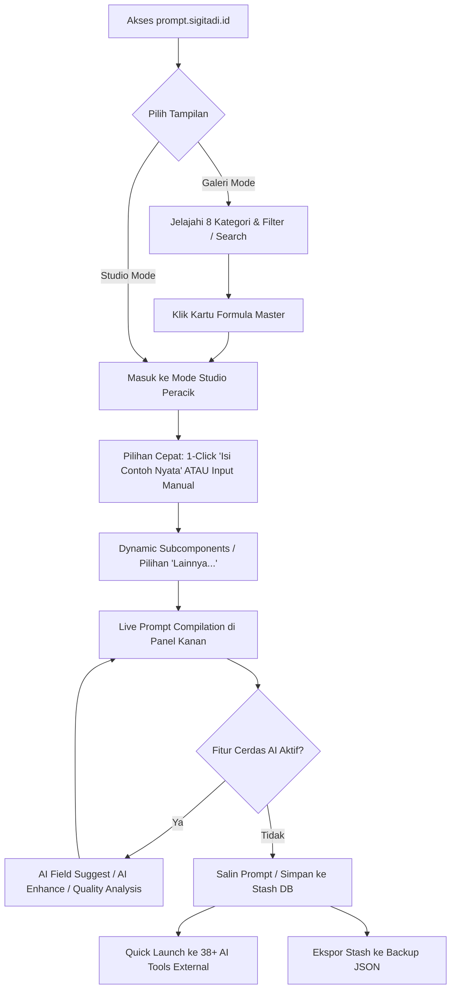

# SPESIFIKASI PRODUK (PRD): PromptMatrix 2.0

> **Sistem:** PromptMatrix 2.0 - Ultimate Guided AI Prompt Generator  
> **Arsitek & Pemilik:** Sigit Adi ([https://sigitadi.id](https://sigitadi.id))  
> **Domain Live:** [https://prompt.sigitadi.id](https://prompt.sigitadi.id)  
> **Versi Saat Ini:** v6.3.1  
> **Lisensi:** MIT  
> **Standar Rekayasa:** Dikelola oleh RetroBOT (`RetroBOT.md`)

---

# ==============================================================================
# ZONA ATAS: BLUEPRINT AWAL (SISTEM & ARSITEKTUR)
# ==============================================================================

## 1. Latar Belakang & Masalah (Problem Statement)
1. **The Blank Canvas Problem:** Pengguna sering mengalami kebuntuan saat berhadapan dengan chatbox AI kosong, menghasilkan prompt yang ambigu, terlalu singkat, atau minim konteks.
2. **Kualitas Output Rendah:** Tanpa persona yang spesifik, batasan format, dan variabel konteks terstruktur, model LLM cenderung berhalusinasi atau memberikan respon umum yang tidak dapat langsung dieksekusi.
3. **Kompleksitas Multi-Modal & Multi-Platform:** Menulis prompt untuk Midjourney v6.1, Suno v4, Runway Gen-3, atau DeepSeek-R1 membutuhkan sintaks, parameter, dan formula yang sangat berbeda satu sama lain.
4. **Isu Privasi Data:** Banyak generator prompt berbasis cloud menyimpan input dan ide pengguna di server pihak ketiga tanpa transparansi.

## 2. Visi Produk & Solusi Utama
PromptMatrix 2.0 adalah platform **Guided AI Prompt Engine** berbasis client-side murni yang menyediakan **350 formula master** lintas 8 kategori industri, memandu pengguna meracik instruksi berkualitas tinggi secara visual, terstruktur, dwibahasa (ID/EN), dan dilengkapi integrasi Universal AI bawaan.

## 3. Persona Pengguna & Peran Sistem
- **Pemula / Casual:** Memanfaatkan fitur *1-Click Fill Sample* dan tombol *Quick Launch* untuk langsung belajar dan mencoba prompt ke ChatGPT/Claude/Gemini.
- **Content Creator & Marketer:** Meracik formula AIDA, PAS, Hook-Story-Offer, Script Video TikTok/Reels, dan Copywriting iklan.
- **Software Engineer & DevOps:** Menggunakan template arsitektur backend, refactoring, unit testing, dan system design prompt.
- **Creative Designer & Musisi:** Mengonstruksi prompt Midjourney berparameter teknis (`--ar`, `--v 6.1`, lighting, lens) dan prompt lirik/genre Suno AI.
- **Power User / AI Enthusiast:** Mengaktifkan fitur AI Pro via *9-Tap Logo Unlock*, menghubungkan API Key Gemini/Claude/DeepSeek/Ollama lokal untuk fitur *AI Suggest*, *AI Enhance*, dan *Quality Scoring*.

## 4. Alur Kerja Pengguna (User Journey / Flow)


## 5. Arsitektur Data & Skema Komponen
- **Master Framework Structure (`data/frameworks.ts`):**
  - Deklaratif, 360 frameworks dalam format hierarkis: `Category -> Subcategory -> Framework`.
  - Termasuk 10 Masterclass Templates 2026: Reasoning Models GCC (Claude 3.7 & DeepSeek-R1), Midjourney v6.1 (--cref & --sref), FLUX.1 Descriptive Studio, Kling 1.5 & Runway Gen-3 Director, Suno v4 Lyrical Architect, AI Coding Agent Rules (.cursorrules & Windsurf), MCP Server & Tool Designer, AIDA Klasik Copywriting, TikTok Shop Live Stream Script, dan LPDP Essay Architect.
  - Komponen input dinamis: `text`, `textarea`, `select`, `slider`, `number`, `multiselect`, `date`, `color`, dan `dynamicSubcomponents`.
- **Lokal Storage & IndexedDB (`PromptMatrixDB`):**
  - Store: `userPrompts` (keyPath: `id`, autoIncrement: `true`).
  - Menyimpan snapshot formulir, prompt hasil kompilasi, timestamp, dan catatan pengguna.
  - Export Stash ke file JSON (backup/restore) dan Markdown `.md` (dokumentasi rapi).
- **Konfigurasi AI (`localStorage`):**
  - Menyimpan API Key, pilihan model, dan custom Base URL secara lokal di browser pengguna (Zero Server Ingestion).
  - Dilengkapi sanitizer otomatis `sanitizePromptText` untuk mencegah kebocoran markdown fence (```markdown) dan bold asterisks (**) saat AI Enhance.

## 6. Antarmuka UI/UX (Human-Crafted Aesthetic)
- **Tema & Warna:** Dark slate premium (`bg-[#090d16]` & `bg-slate-900`) dengan aksen emerald (`teal-500/emerald-400`) dan purple AI accents.
- **Layout:**
  - *Galeri View*: Grid responsif kartu formula dengan visual badges, count pill, intent search tags, dan zero-emoji SVG icons (termasuk pada Stash modal).
  - *Studio View*: Split 2 kolom (58% formulir bertahap & 42% sticky live preview dengan hitungan karakter dan perkiraan token).
- **Aksesibilitas & Resiliensi:** ErrorBoundary mempertahankan API keys (`pm_ai_settings`) dan status aktivasi (`pm_ai_unlocked`) saat pengguna melakukan reset cache darurat.
- **Performa Bundling:** Vite code-splitting via `manualChunks` memecah bundle data (`data-frameworks`, `data-localization`, `vendor-react`) sehingga bundle utama berukuran ultra-ringan (~147 kB).

## 7. Rencana Pengujian & Kriteria Keberhasilan
- Build tanpa error pada Vite + TypeScript strict mode (< 4 detik).
- 100% dari 360 formula terkompilasi dengan bersih ke format `AI Logic: ...` dan variabel input.
- Sinkronisasi dual-bahasa (ID ↔ EN) konsisten di 4.300+ entri tanpa kunci translasi yang hilang.
- Fungsi IndexedDB (Create, Read, Update, Delete, Export JSON, Export Markdown, Import) berjalan tanpa konflik ID.

---

# ==============================================================================
# ZONA BAWAH: LIVING CONTEXT (STATUS AKTIF & REGISTER TEKNOLOGI)
# ==============================================================================

### Status Sistem Terkini (v6.4.2)
- **Framework Utama:** React 18.0.0 (Functional Components + Hooks)
- **Bahasa & Compiler:** TypeScript 5.5.4 + Vite 5.4.19
- **Styling Engine:** Tailwind CSS v4.1.10 + PostCSS 8
- **Penyimpanan Klien:** Native IndexedDB (`db.ts`, Store: `userPrompts`) + Safe LocalStorage
- **Hosting & CI/CD:** GitHub Actions -> GitHub Pages + Vercel / Netlify Rewrite Ready (`public/CNAME`, `public/_redirects`)
- **Domain Resmi:** `https://prompt.sigitadi.id`
- **Total Master Formulas:** 360 Formulas Terverifikasi (100% Searchable, Localized Dua Arah ID ↔ EN)
- **Responsivitas & Layout:** 100% Non-scrolling static category grid (2-kolom mobile / 3x3 desktop), Tombol AI tersembunyi total saat belum diaktifkan (9-tap logo unlock), Touch Target >= 40px, Zero Horizontal Overflow.

### Register Modul & Komponen Utama
| Berkas / Direktori | Tanggung Jawab Teknis |
| :--- | :--- |
| `App.tsx` | State orchestrator utama (viewMode, formValues, stash CRUD & Export MD, toast, prompt compiler, 9-tap logo unlock) |
| `components/TemplateGallery.tsx` | Galeri visual 360 kartu formula, 20 quick search tags, pencarian berbasis sinonim/intent, category switcher |
| `components/FrameworkPane.tsx` | Formulir interaktif dinamis, tombol *1-Click Isi Contoh Nyata*, AI suggestion per-field |
| `components/Header.tsx` | Navigasi atas, logo tap trigger, language switcher (ID/EN), stash modal badge |
| `components/Footer.tsx` | Metadata, copyright Sigit Adi, navigasi dokumentasi & lisensi |
| `components/AISettingsModal.tsx` | Modal konfigurasi multi-provider AI (Gemini, Claude, OpenAI, DeepSeek, Ollama, Custom URL) |
| `services/universalAIService.ts` | Dispatcher universal pemanggilan AI multi-provider dengan SSE stream parser, error handler, dan sanitizer markdown |
| `services/aiSettingsService.ts` | Manajemen preset provider, model default, dan persistensi `localStorage` |
| `services/localizationService.ts` | Basis data translasi 4.300+ frasa & mapping bilingual ID ↔ EN presisi (360 framework names & descriptions) |
| `services/sampleDataService.ts` | Data sample realistis untuk pengisian formulir otomatis 1-klik (didukung dictionary cerdas 2026) |
| `data/frameworks.ts` | Master repository 360 framework dan definisi komponen dinamis |
| `db.ts` | Wrapper IndexedDB untuk Stash (CRUD + JSON Export/Import) |

### Fitur Rahasia & Kontrol Akses (Security by Discretion)
- **9-Tap Logo Unlock:** Tombol logo pada header dapat diklik 9 kali berturut-turut untuk membuka/menutup fitur AI Pro (`pm_ai_unlocked`). Saat aktif, tombol *Suggest AI*, *AI Enhance*, dan *Quality Analysis* akan muncul pada Studio Peracik.
